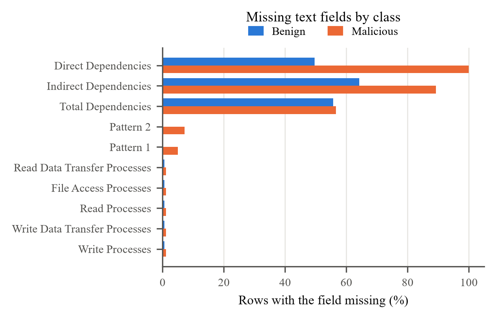
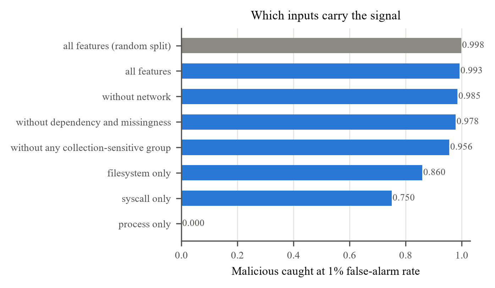
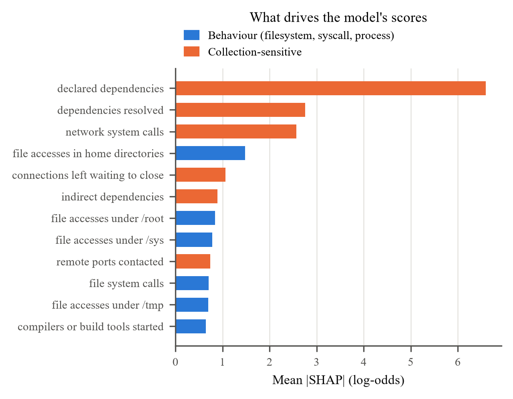
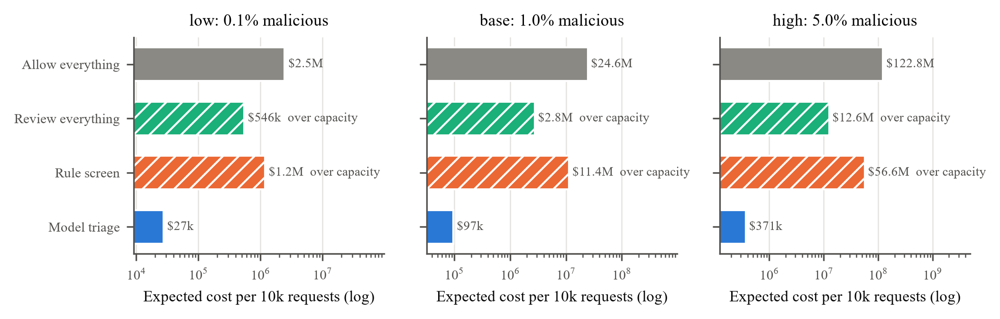
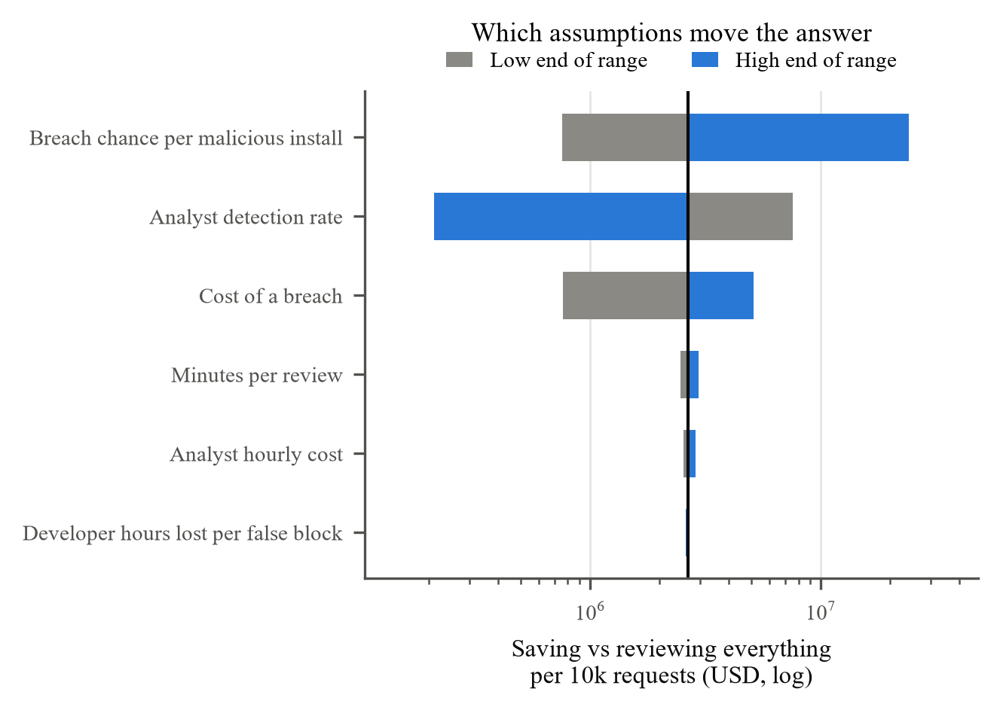
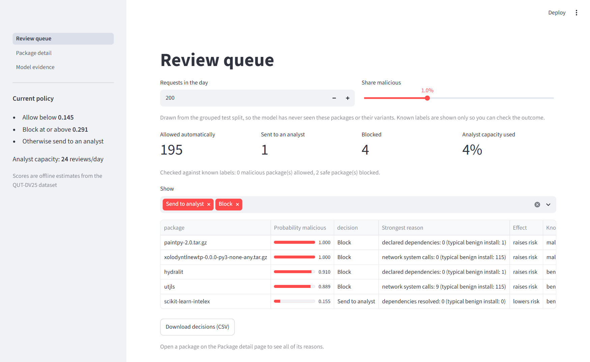
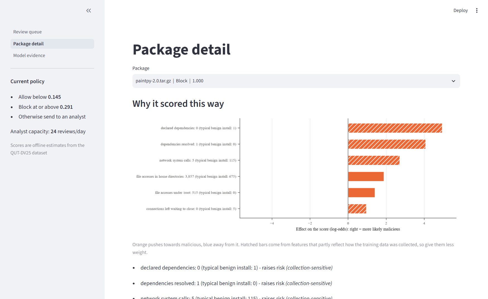
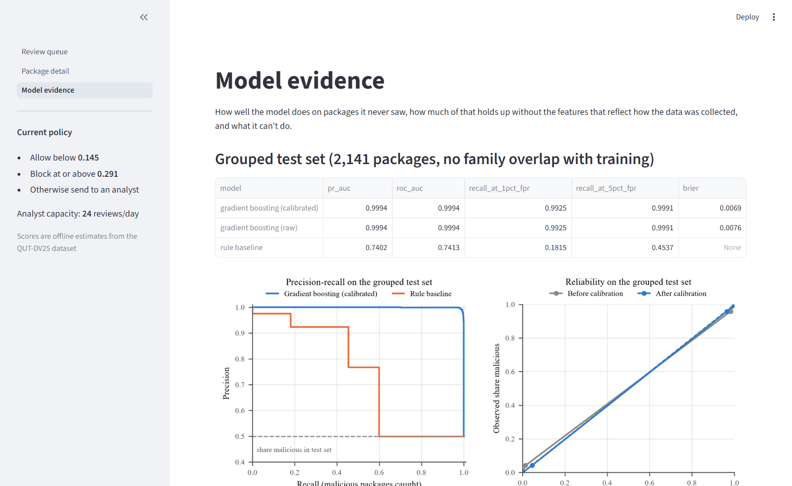

# Malicious Package Detection for Software Supply-Chain Security

**MSc Data Analytics, Domain Applications, National College of Ireland**

A triage tool that watches what a Python package **does while it installs** in a sandbox and tells a
security team whether to **allow** it, **send it to an analyst**, or **block** it, and what that
decision is worth in analyst time, missed attacks and cost.

---

## The problem

Anyone can publish to PyPI. Attackers upload packages with names one keystroke away from popular
ones (`beautiifulsoup4` instead of `beautifulsoup4`), and the harmful code often runs the moment
someone types `pip install`.

| | Numbers |
|---|---|
| Malicious open-source packages found 2019-2024 | **704,000+** (Sonatype) |
| Average cost of a supply-chain breach | **USD 4.91M** (IBM, 2025) |
| Requests a two-person security team has to vet | **~200 a day** (assumption) |

A small team has three bad options today: review everything (needs about 17 analysts), use simple
rules (miss most attacks), or let everything through.

---

## Base paper: DySec

**DySec** (Mehedi et al., 2025, [arXiv:2503.00324](https://arxiv.org/abs/2503.00324)) installs each
PyPI package in an isolated sandbox and records its behaviour with eBPF and strace: files touched,
network connections, processes started, dependencies resolved and system-call patterns. It reports
**about 96% accuracy**. The traces are public as **QUT-DV25**: 14,270 packages, half malicious.

DySec shows behaviour works. It stops at a label.

---

## Research gaps and how this project closes them

| Gap in the base study | What this project does |
|---|---|
| **G1. The test is easier than real life.** Malicious packages were installed from local files, safe ones from PyPI, and near-copies of the same package sit on both sides of a random split. | Drops the giveaway fields, splits by **package family**, and retrains on **behaviour only** to measure how much the install method helps |
| **G2. Real attacks are rare.** The data is 50/50; in a company perhaps 1 request in 100 is malicious. | Re-prices every business result at **0.1%, 1% and 5%** malicious and reports how many blocks are real attacks |
| **G3. A score is not a decision.** No allow/review/block, no analyst capacity, no cost. | Chooses **allow / review / block thresholds** that minimise expected cost within the team's daily capacity |

No new algorithm and no algorithm bake-off: **one existing model**, applied to a real business decision.

---

## How it works

```
                 Developer asks to install a package
                                 |
              Sandbox installs it once and records a trace
                                 |
          49 behaviour features (files, network, syscalls, processes)
                                 |
            Calibrated gradient boosting  ->  P(malicious)
                                 |
          +----------------------+----------------------+
          |                      |                      |
        Allow            Send to an analyst        Block (quarantine,
     P < 0.145          with the SHAP reasons       appeal)  P >= 0.291
```

- **Model:** scikit-learn `HistGradientBoostingClassifier`, tuned with 5-fold cross-validation grouped
  by package family, then **calibrated** so that a score of 0.8 means about 80% likely malicious.
- **Thresholds:** chosen on the validation set to **minimise expected cost** (review time + missed
  attacks + wrongly blocked packages) while the review queue fits a two-person team (24 a day).
- **Explanations:** every decision shows its strongest **SHAP** reasons in plain words, for example
  *"file accesses in home directories: 3,857 (typical benign install: 675)"*.
- **Baseline:** six hand-written rules (root, /etc and home-folder access, shell tools...) of the kind
  a security team would write without machine learning.

---

## What the data audit found

The dataset is real and useful, but the two classes were collected differently.

<p align="center"></p>

- Every malicious package has an archive name (`x-1.0.tar.gz`); **no** benign one does. The name is never used as a feature.
- Dependency fields are empty for **99.99%** of malicious packages but only 49.6% of benign ones. That one blank field alone gives a ROC-AUC of 0.75.
- **1,895** packages are near-copies in 585 families (one has 41 versions). A random split would leak **256** of them into the test set; the family split leaks none.

---

## Results

Tested once on **2,141 packages from families the model never saw**.

| Model | PR-AUC | Malicious caught at 1% false alarms |
|---|---|---|
| **Gradient boosting (calibrated)** | **0.999** | **99.3%** |
| Same model, **behaviour only** (no install-method clues) | 0.997 | **95.6%** |
| Six hand-written rules | 0.740 | 18.2% |

<p align="center"></p>

**The honest finding:** about two-thirds of the full model's SHAP attribution falls on features
affected by how packages were installed. Take them away and it still catches **95.6%** of attacks,
so the behaviour signal is real, but **95.6% is the number to trust** for a company where every
package is installed the same way.

<p align="center"></p>

---

## Business value

Per **10,000 requests** with **1% malicious** and a two-person team:

| Policy | Reviews a day | Attacks missed | Safe packages blocked | Expected cost |
|---|---|---|---|---|
| Allow everything | 0 | 100 | 0 | $24.6M |
| Simple rules | 37 | 46 | 0 | $11.4M |
| Review everything | 200 (~17 analysts) | 10 | 0 | $2.76M |
| Model, behaviour only | 18 | 0.6 | 674 | $255k |
| **Model triage** | **2.4** | **0.3** | **139** | **$98k** |

- **Two analysts are enough**: the model sends 2.4 packages a day to a person instead of 200.
- **Saves about $2.66M** per 10,000 requests against reviewing everything (**$2.50M** with the behaviour-only model), so the business case does not depend on the install-method shortcut.
- **One honest catch:** attacks are rare, so at 1% malicious only **42% of blocks are real attacks**. A block should work like airport security: a quarantine with a quick appeal, not a final verdict.

<p align="center"></p>

The ranking holds at every attack rate. The saving depends most on how likely a malicious install
is to become a breach, and on how reliable human reviewers are:

<p align="center"></p>

All savings are **offline estimates** under labelled assumptions in
[`configs/business.yaml`](configs/business.yaml); only the breach cost is a published figure.

---

## Dashboard preview

A small Streamlit app with three pages.

**Review queue:** a simulated day of requests from held-out packages, checked against the team's capacity



**Package detail:** why one package scored the way it did. Hatched bars come from install-method features, which analysts should weight less



**Model evidence:** test results, calibration and known limits



---

## How to run

Python 3.12. On Windows, `tasks.ps1` runs every step in order:

```powershell
.\tasks.ps1 setup  # virtual environment + pinned dependencies
.\tasks.ps1 all     # download -> audit -> features -> train -> evaluate -> business results (~7 min)
.\tasks.ps1 app  # dashboard at http://localhost:8501
.\tasks.ps1 test   # 87 automated tests
```

Or step by step:

```bash
python -m venv .venv
.venv\Scripts\activate
pip install -r requirements.txt
pip install -e . --no-deps

python scripts/download_data.py  # QUT-DV25 from Hugging Face, checksum verified
python scripts/run_data_audit.py  # validation, artefact audit, EDA figures
python scripts/build_dataset.py # 49 features + family-grouped 70/15/15 split
python scripts/train_model.py     # tuning, training, calibration (~3 min)
python scripts/evaluate_model.py     # test results, ablations, SHAP
python scripts/run_business_simulation.py  # thresholds, costs, scenarios, sensitivity
streamlit run app/streamlit_app.py  # dashboard
```

`python scripts/check_reproducibility.py` rebuilds the data, split and model and checks they match
the saved results (5 of 5 checks pass).

---

## Project structure

```
app/       Streamlit dashboard (review queue, package detail, model evidence)
configs/      dataset version, split, seed and every business assumption with its source
data/    download instructions and split lists (raw data is not committed)
images/    every figure, made with matplotlib
reports/tables/   the CSV results every number above comes from
scripts/    pipeline steps, run in order
src/pkgtriage/    the Python package: data, features, models, business, services
tests/    87 unit, integration and acceptance tests
```

---

## Limitations

- One dataset and one sandbox; all savings are offline estimates, not measured in a company.
- Malware that waits until it is imported is invisible to installation traces.
- Benign labels were not independently checked.
- The tool supports decisions; an analyst can override every block.

---

## Credits

Dataset and base approach: Sk Tanzir Mehedi, Raja Jurdak, Chadni Islam and Gowri Ramachandran
(Queensland University of Technology), MIT licence.

- *DySec: A Machine Learning-based Dynamic Analysis for Detecting Malicious Packages in the PyPI Ecosystem*, [arXiv:2503.00324](https://arxiv.org/abs/2503.00324)
- *QUT-DV25: A Dataset for Dynamic Analysis of Next-Gen Software Supply Chain Attacks*, NeurIPS 2025, [arXiv:2505.13804](https://arxiv.org/abs/2505.13804)
- Data mirror: [Hugnd-UIT/ML-Based-Malicious-Package-Detection](https://huggingface.co/datasets/Hugnd-UIT/ML-Based-Malicious-Package-Detection) on Hugging Face
